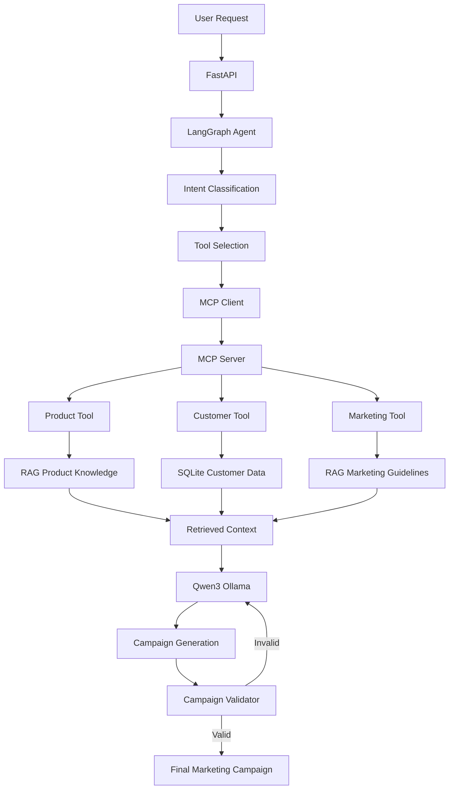

**AI Marketing Copilot**

An Agentic AI marketing assistant built with Python, LangGraph, RAG, MCP, FastAPI, and Qwen3/Ollama.

It analyzes marketing requests, selects relevant tools, retrieves product and customer context, generates campaigns, and validates the output.

 **Features**

- Agentic AI workflow with LangGraph
- Local Qwen3 LLM using Ollama
- RAG with Sentence Transformers and vector search
- MCP client-server tool architecture
- Customer segmentation with SQLite
- Campaign validation and retry
- REST API using FastAPI
- Automated testing with Pytest

 **Tech Stack**

Python · LangGraph · Qwen3 · Ollama · RAG · MCP · FastAPI · SQLite · Sentence Transformers · Pytest · Git

 **Architecture**

 **Run Locally**

**cmd**

git clone https://github.com/JafsinJaleel/marketing-copilot.git

cd marketing-copilot

python -m venv venv

venv\Scripts\activate

pip install -r requirements.txt

ollama pull qwen3:4b

uvicorn app.api.main:app --reload

API: `http://127.0.0.1:8000`

Swagger: `http://127.0.0.1:8000/docs`

**Testing**
**cmd**

pytest -q

